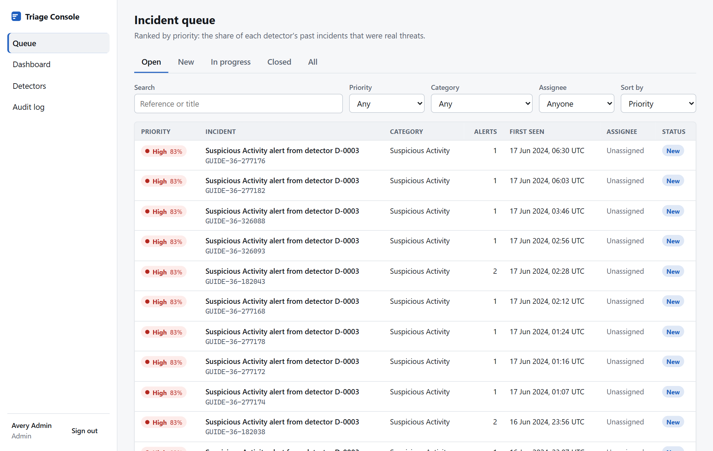
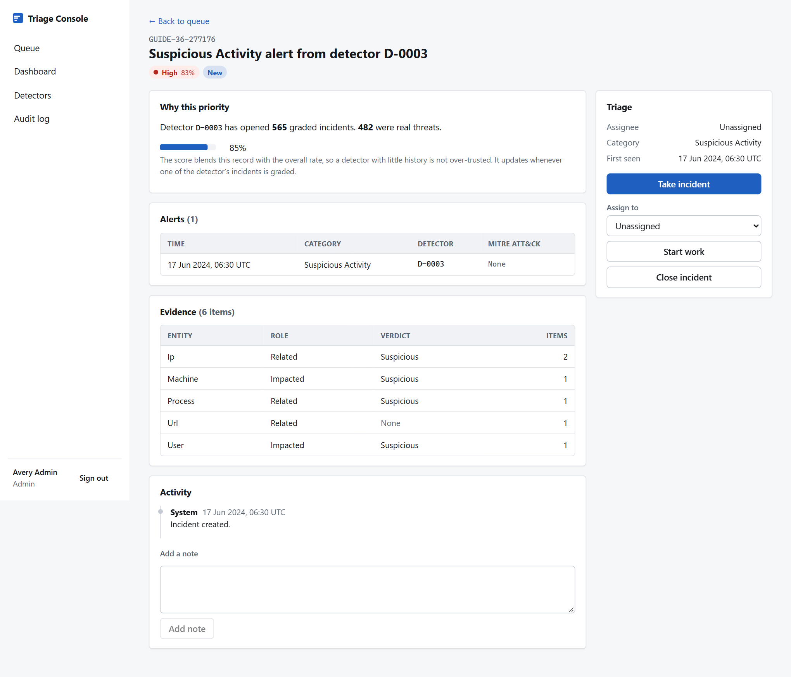
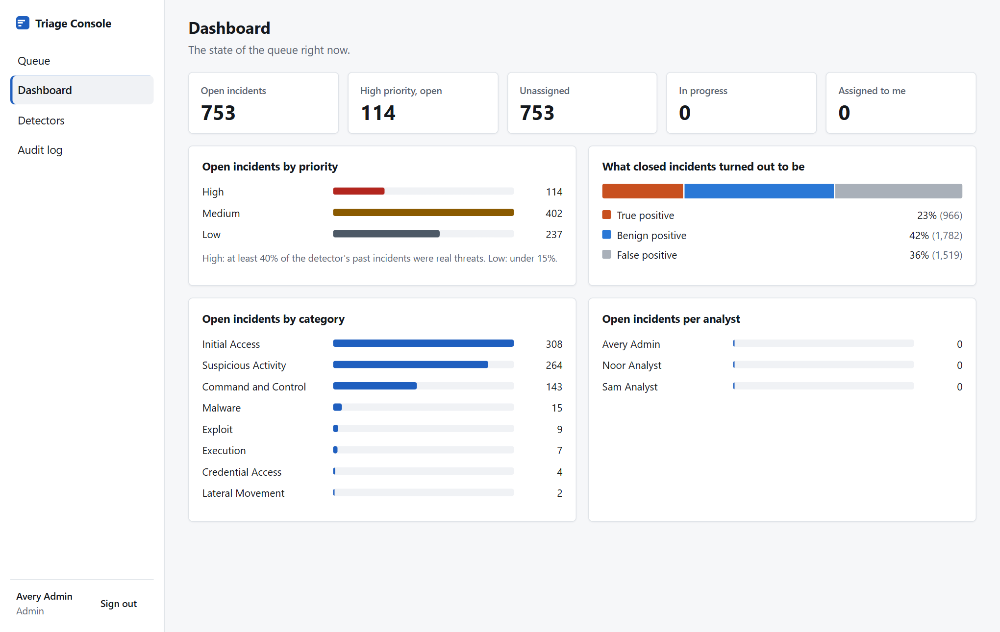
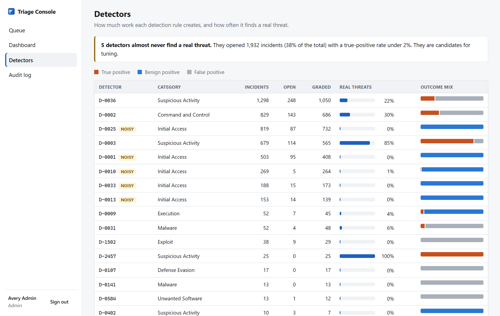
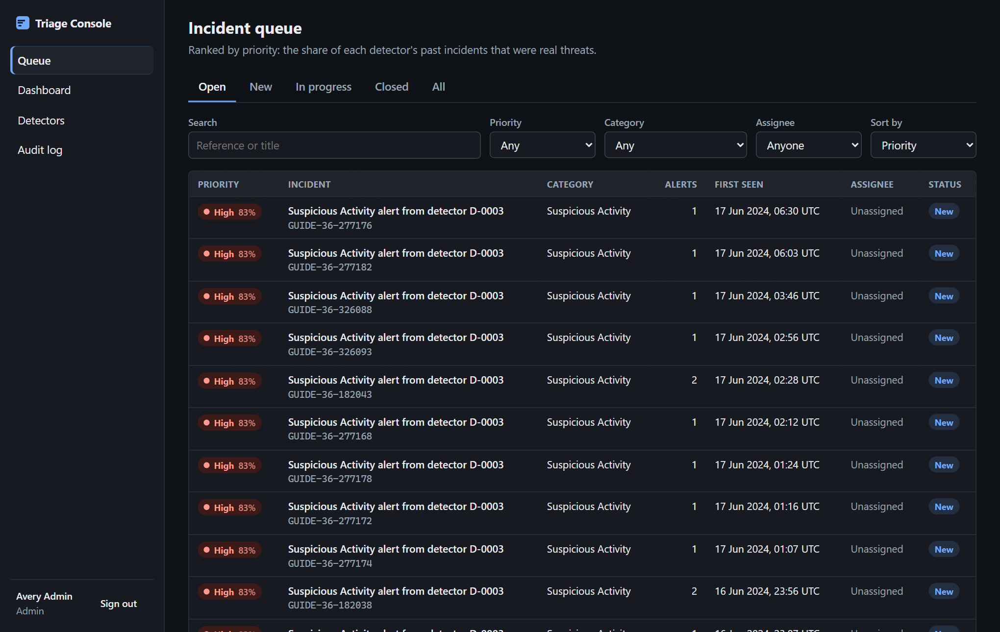

# SOC Triage Console

A full-stack security operations console. Analysts work a queue of security incidents that
ranks itself: each incident is scored by how often its detector has found a real threat
before, and the ranking updates every time an analyst grades one.

**Stack:** React 19 · TypeScript · Node.js (Express 5) · PostgreSQL · Vitest · Docker · GitHub Actions



## What it does

| | |
|---|---|
| **Self-ranking queue** | Open incidents sorted by priority, with filters for status, priority, category and assignee, search, and server-side pagination. Filters live in the URL, so any view can be bookmarked or shared |
| **Triage workflow** | Take an incident, start work, close it with a grade (true positive, benign positive, false positive), reopen it, add notes |
| **Explained priority** | Every incident shows why it is ranked where it is: its detector's track record |
| **Role-based access** | Viewer (read-only), analyst (works own incidents), admin (assigns anyone, reads the audit log). Enforced on the server for every request |
| **Audit trail** | Every change is recorded in the same database transaction as the change itself |
| **Concurrent edits** | If two people change the same incident, the second is told and shown the latest state instead of silently overwriting |
| **Dashboard and detector report** | Queue health at a glance, and which detection rules create work without finding threats |

| Incident detail | Dashboard |
|---|---|
|  |  |

| Detectors | Dark theme |
|---|---|
|  |  |

## Run it

Requires Node.js 22 or newer. No database to install: with no `DATABASE_URL`, the API runs
PostgreSQL in-process ([PGlite](https://pglite.dev)) and seeds itself on first start.

```bash
npm install
npm run dev
```

Open http://localhost:5173. The sign-in page offers one-click demo accounts for each role
(local development only; the accounts are defined in `server/src/seed/demo-users.ts`).

```bash
npm test          # 44 tests: 32 API, 12 front end
npm run typecheck
npm run build
```

### Real data

The screenshots use one organisation's incidents from Microsoft's
[GUIDE dataset](https://www.kaggle.com/datasets/Microsoft/microsoft-security-incident-prediction):
5,020 real, anonymized incidents with 9,824 alerts and 58,357 evidence items. The dataset is
not included in this repository. To load it, download `GUIDE_Train.csv` and run:

```bash
npm run seed:guide -w server -- path/to/GUIDE_Train.csv
```

The 2.4 GB file is streamed, so the import takes about ten seconds. The most recent 15% of
incidents are loaded as open work; the rest are loaded as graded history. `npm run seed`
goes back to the built-in synthetic data.

### With a PostgreSQL server

```bash
cp .env.example .env     # set SESSION_SECRET and DEMO_PASSWORD
docker compose up --build
```

Then open http://localhost:4000. The same SQL runs against both databases; only the driver
differs (`server/src/db/index.ts`).

## How the ranking works

An incident's priority is its detector's smoothed true-positive rate:

```
score = (true_positives + 20 × overall_rate) / (graded_incidents + 20)
```

The smoothing stops a detector with three graded incidents from being trusted like one with
three thousand. When an analyst closes an incident, the scores of that detector's other open
incidents are recalculated in the same transaction (`server/src/priority.ts`), so the queue
re-ranks as the team works. Reopening an incident withdraws its grade and the scores move back.

The rule comes from a companion analysis,
[security-alert-triage](https://github.com/vishnukanchi9/security-alert-triage), where it put
49% of real threats in the first fifth of a held-out queue of 303,000 incidents, against 20%
in arrival order.

## Design decisions

**Authorization is on the server.** The UI hides buttons a role cannot use, but every route
checks the role and the rules again: an analyst can only take an incident or release their
own, must hold an incident to change its status, and cannot be bypassed by calling the API
directly. The tests call the API as each role to prove it.

**Optimistic locking.** Each incident has a `version`. A write quotes the version it read;
the server locks the row (`SELECT ... FOR UPDATE`), compares, and returns `409` on a mismatch.
The UI shows the message and reloads the incident.

**The audit trail cannot drift.** The change and its audit row are written in one
transaction, so there is never a change without a record or a record without a change. A
database `CHECK` constraint also guarantees a closed incident always has a grade.

**Sessions.** A signed JWT in an `httpOnly`, `SameSite=Lax` cookie (and `Secure` in
production): not readable by scripts, not sent on cross-site POSTs. Passwords are hashed with
scrypt and a per-password salt. Sign-in gives the same answer for an unknown email and a wrong
password, and locks out after repeated failures.

**SQL, written by hand.** Queries are parameterized SQL rather than an ORM: filtered,
paginated listing, conditional aggregates for the dashboard, and the set-based re-scoring
`UPDATE`. Search input is escaped so `%` and `_` are matched literally.

**One database interface, two engines.** PGlite is real PostgreSQL compiled to WebAssembly.
It makes the project run with one command and lets the API tests run against a real database
in memory, with no mocks and no Docker.

## Project structure

```
server/
  src/
    app.ts                 Express app: security headers, sessions, routes, error handling
    auth.ts                Password hashing, session tokens, role guards
    priority.ts            The scoring rule and re-scoring queries
    db/                    Database interface, both drivers, migration runner, schema
    routes/                auth, incidents (queue, detail, workflow), insights (dashboard, detectors, audit)
    seed/                  Demo users, synthetic data generator, GUIDE importer
  test/                    API tests against in-memory PostgreSQL
web/
  src/
    api.ts                 Typed API client
    auth.tsx               Session context
    pages/                 Login, Queue, Incident, Dashboard, Detectors, Audit
    components/ui.tsx      Badges, pagination, bars
    styles.css             Design tokens, light and dark themes, responsive layout
scripts/screenshots.mjs    Regenerates the README screenshots
```

## Accessibility

Priority is always a word and a number, never colour alone. Charts carry text equivalents for
screen readers. All controls are reachable by keyboard with visible focus, form fields have
labels, tables use header cells, and the layout works from 375px wide. Light and dark themes
follow the system setting.

## Limitations

- **The Docker setup has not been run end to end.** The production build was verified by
  running the compiled server directly; `docker compose up` was written but not executed.
- The sign-in lockout is held in memory, so it resets on restart and is per-process.
- There is no user management screen; accounts come from the seed.
- Incident titles are generic because GUIDE anonymizes alert titles and detector names.
- The front-end tests cover components and URL handling; the full workflow was checked in a
  real browser by script, but that script is not part of the automated test suite.
